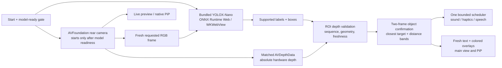

# Architecture and technology stack for the presentation

Verified shipped software baseline: `main` after #37/#38, native integration `292731b`. An installed phone may still be older. Floor mode is a separate design-only draft, not part of this diagram's implemented path.

## One-slide native architecture

“Model ready” is a prerequisite for initial camera access, not a requirement to wait for a model result before updating the live preview. Neural detection and the raw sensor lane remain separate. Stop/interruption/generation guards prevent old work from resurrecting capture or feedback.

## Actual stack

| Layer | Technology used | Honest explanation |
| --- | --- | --- |
| Native UI/state | Swift, SwiftUI, UIKit | Controls, accessibility text, settings, overlays and main-actor state. |
| Camera and hardware depth | AVFoundation, AVCaptureSession, AVCaptureDepthDataOutput, AVCaptureDataOutputSynchronizer, AVDepthData | One capture system. Matched timestamps and geometry are required. Depth is approximate optical-axis surface depth, not safe clearance. |
| Native inference | WKWebView / WebKit, ONNX Runtime Web **1.20.1**, single-thread WASM, experimental fine-tuned **YOLOX-Nano** | Runtime and model are bundled. It is not Core ML, ARKit or cloud inference. Candidate quality limitations are documented. |
| Feedback | AVAudioPlayer / AVSpeechSynthesizer, UIKit impact/notification feedback, pure Swift policy and scheduler | Respect selected modes, bound cadence, cancel stale work. No Apple Critical Alerts entitlement claim. |
| Native PiP | AVKit video-call Picture in Picture + sample-buffer display | Native overlays can be shown. Camera/background behavior is capability-limited, not guaranteed continuously. |
| Browser fallback | HTML, CSS, JavaScript, TensorFlow.js **4.22.0**, WASM, **COCO-SSD lite_mobilenet_v2** | Separate browser model. First-load assets are fetched and cached by a service worker. Default scanning does not need a backend or distance model. |
| Hosted preview | Existing Cloudflare Worker static-assets deployment | Serves the judging web app. Not the native inference backend and not a new paid resource. |
| Optional comparison API | Node.js 24+, **Fastify 5.12.7**, TFJS/COCO-SSD | Retained separate API path. Do not say it is in the native demo's critical path. |
| Verification | Xcode/Swift compiler, Node's test runner, executable Swift tests, Playwright/Chrome, GitHub Actions | Builds and controlled tests are not physical sensor accuracy or user-study evidence. |

## Architecture refinements already made

- **Explicit startup boundary:** `ModelFirstStartup` and the browser `prepare` gate prevent camera access before actual model readiness.
- **Separate sensor and neural lifecycles:** center-surface diagnostics no longer depend on waiting for inference; object depth still requires matched image evidence.
- **Pure distance policy:** `ProximityPolicy` handles validated thresholds, spatial identity, confirmation and hysteresis without owning UI/audio.
- **Explicit alert routing:** `ProximityAlertRoute` separates measured in-range feedback, out-of-range silence, and generic unknown-depth detection warnings.
- **Bounded output ownership:** `ProximityFeedback` schedules one loop with freshness checks; `AlertPlayer` owns platform outputs and handoffs rather than multiple independent alert queues.
- **Independent display expiry:** main/PiP labels do not keep a stale distance alive just because a box remains visible.

These are targeted boundary improvements, not a late rewrite. The next architectural change belongs in the separate floor-mode PR: retain validated calibration, add timestamped CoreMotion gravity, and keep geometric observations independent from neural model throughput.

## What is not implemented or not verified

- Floor-mode geometry/CoreMotion integration: design-only [PR #40](https://github.com/AdityaDave2008/DAHacks26-AD-BW-YT-NQ-DK/pull/40).
- Personalized passage width, wheelchair clearance, directional guidance, universal hazard coverage and reliable pothole detection: not delivered.
- Physical judging-phone distance accuracy, actual alert cadence and the latest installed build: pending a reachable phone and reference measurements.
- Accessibility effectiveness, safe navigation, guaranteed background operation and improved classifier accuracy: not established.

## Evidence links

- [Model-first startup and deployment acceptance](MODEL_LOADING_ACCEPTANCE.md)
- [Distance feedback and physical checklist](PROXIMITY_ACCEPTANCE.md)
- [Native model provenance and preprocessing limits](../samples/ios/MyEyes/OfflineDetector/PROVENANCE.md)
- [Training results, including precision/recall caveats](../training/RESULTS.md)
- [Four-minute pitch and two-minute Q&A](PRESENTATION_4_MINUTES.md)
